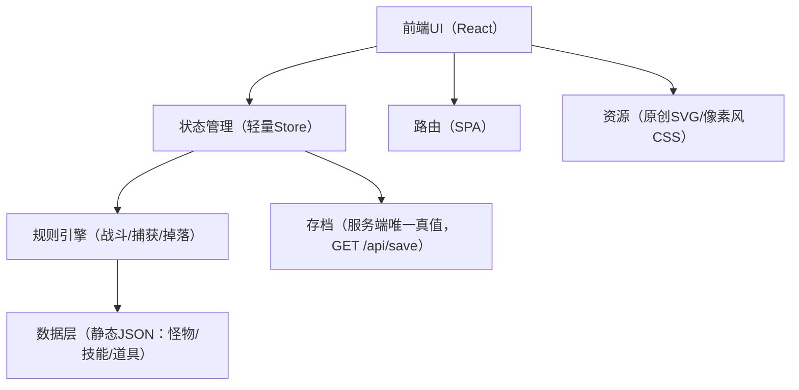

## 1. 架构设计

## 2. 技术说明
- 前端：React@18 + TypeScript + Vite
- 样式：tailwindcss@3（配合CSS变量实现主题与像素边框组件）
- 路由：react-router-dom（仅前端路由）
- 数据：静态内容表 `src/game/data.ts`（后端 `check:content` 校验两端一致）
- 后端：Node + TypeScript（Fastify 4 + Prisma 5 + Postgres 16 + Redis），见 `.trae/documents/后端开发规范_backend.md`
- 存档：**服务端唯一真值**（`GET/PUT /api/save`，行版本 CAS）；本地不保留任何存档副本（2026-11-13 起）

## 3. 路由定义
| 路由 | 用途 |
|---|---|
| / | 启动页（新游戏/继续/导入导出/设置） |
| /camp | 营地（队伍/背包/图鉴/训练场入口/进度） |
| /arena | 训练场（对战+捕获） |

## 4. API 定义
设备端只与自建后端通信：`/api/auth/*`、`/api/save`、`/api/game/*`、`/api/actions/*`、`/api/battle/*`、`/api/wild`、`/api/room/*`、`/api/pvp/*`、`/api/coop/*`、`/api/boss/*`、`/api/mapboss/*`、`/api/rank/*`、`/api/health`。完整契约见后端开发规范。

## 5. 服务端架构
Fastify 4 + Prisma 5 + Postgres 16（唯一真值）+ Redis（锁 / 租约 / pub-sub / 可重建临时态，**不存权益真值**）。服务端权威，客户端只发意图、收状态、渲染。不变式与模块边界见 `.trae/documents/后端开发规范_backend.md` 与 `P5-1_F10_迁移实施设计定稿与工单_2026-11-11.md`。

## 6. 数据模型
### 6.1 数据模型定义

```mermaid
erDiagram
  SAVE ||--o{ PARTY_SLOT : "contains"
  SAVE ||--o{ COLLECTION_ENTRY : "contains"
  SAVE ||--o{ INVENTORY_ITEM : "contains"
  MONSTER_SPEC ||--o{ MONSTER_INSTANCE : "instantiates"
  MOVE_SPEC ||--o{ MONSTER_INSTANCE : "has moves"

  SAVE {
    string version
    string playerName
    int money
    int steps
    string lastSavedAt
  }

  PARTY_SLOT {
    int index
    string monsterId
  }

  COLLECTION_ENTRY {
    string monsterSpecId
    boolean seen
    boolean captured
    int timesCaptured
  }

  INVENTORY_ITEM {
    string itemId
    int quantity
  }

  MONSTER_SPEC {
    string id
    string name
    string element
    int baseHp
    int baseAtk
    int baseDef
    int baseSpd
    int captureRate
  }

  MOVE_SPEC {
    string id
    string name
    string element
    int power
    int accuracy
    string effect
  }

  MONSTER_INSTANCE {
    string id
    string specId
    int level
    int hp
    int maxHp
    int atk
    int def
    int spd
    string status
    string[] moveIds
    int exp
  }
```

### 6.2 数据定义语言
不使用数据库，数据以TS/JSON静态文件维护；存档以JSON结构持久化。
