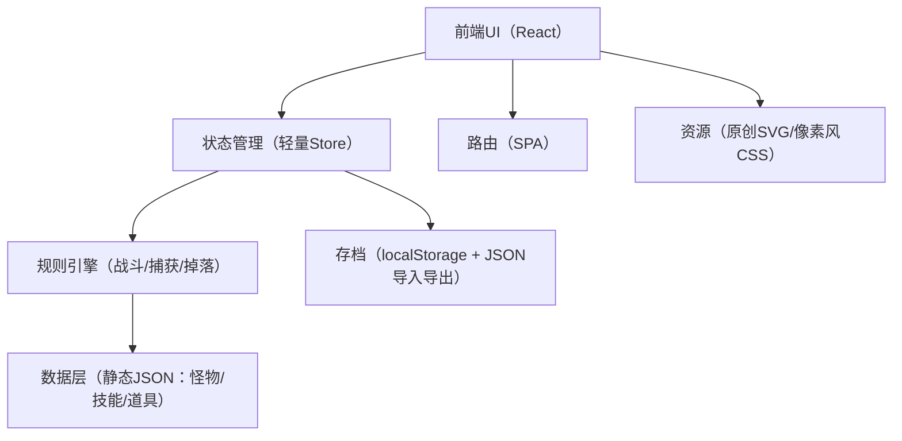
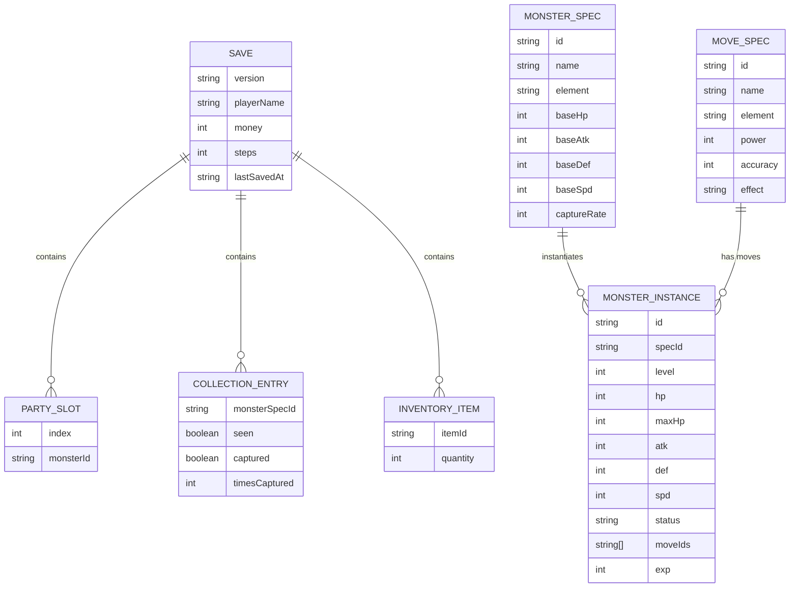

## 1. 架构设计

## 2. 技术说明
- 前端：React@18 + TypeScript + Vite
- 样式：tailwindcss@3（配合CSS变量实现主题与像素边框组件）
- 路由：react-router-dom（仅前端路由）
- 数据：本地静态数据（JSON/TS常量），无后端、无外部服务
- 存档：localStorage（自动保存）+ 文件导入导出（JSON）

## 3. 路由定义
| 路由 | 用途 |
|---|---|
| / | 启动页（新游戏/继续/导入导出/设置） |
| /camp | 营地（队伍/背包/图鉴/训练场入口/进度） |
| /arena | 训练场（对战+捕获） |

## 4. API 定义
无后端API。

## 5. 服务端架构图
无（纯前端静态站点）。

## 6. 数据模型
### 6.1 数据模型定义

### 6.2 数据定义语言
不使用数据库，数据以TS/JSON静态文件维护；存档以JSON结构持久化。
